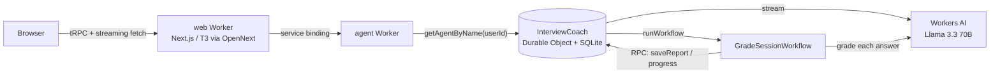

# Interview Coach

An AI mock-interview coach that runs on Cloudflare. It interviews you one question at a time, grades the whole session in a durable background workflow, and **remembers** your strengths and weak spots so the next interview targets them.

| Component                      | How this app meets it                                                                                                                                                                                                                                                                             |
| ------------------------------ | ------------------------------------------------------------------------------------------------------------------------------------------------------------------------------------------------------------------------------------------------------------------------------------------------- |
| **LLM**                        | Llama 3.3 70B (`@cf/meta/llama-3.3-70b-instruct-fp8-fast`) on **Workers AI**. It runs the interview (streamed) and grades answers (JSON-schema mode).                                                                                                                                             |
| **Workflow / coordination**    | A **Cloudflare Workflow** (`GradeSessionWorkflow`) grades each answer in its own durable, retryable step, writes a debrief and updates memory. An **Agents SDK Durable Object** coordinates chat, state and workflow callbacks.                                                                   |
| **User input (chat or voice)** | A **Next.js app built with create-t3-app** (tRPC, Tailwind), deployed to **Workers** with OpenNext. It has streaming chat, voice dictation (Web Speech API) and optional read-aloud.                                                                                                              |
| **Memory / state**             | Each candidate gets their own `InterviewCoach` Durable Object with an embedded **SQLite** database. It holds the profile, every session, transcripts, reports, and long-term memory notes that feed back into the interviewer's prompt. Live grading progress uses the Agents SDK's synced state. |

## How it works



1. **Chat.** The browser posts each answer to a Next.js route handler. The handler forwards it over a service binding to the agent Worker, which routes to the candidate's `InterviewCoach` Durable Object. The agent stores the answer, builds the interviewer prompt (role, level, focus, **memory notes**, and **questions asked in past sessions** so it doesn't repeat them), and streams Llama 3.3's reply back to the browser as it's generated. The reply is saved even if the browser disconnects mid-stream.
2. **Grade.** "End & grade" starts `GradeSessionWorkflow` with `this.runWorkflow()`. The workflow pairs each question with its answer, grades each pair in its own `step.do` with retries (score, strengths, improvements, and a stronger example answer), then writes a debrief. It reports progress back to the agent, and the UI shows it live.
3. **Remember.** The summarize step merges this session's findings into a short list of coaching notes ("Strength: …", "Work on: …", "Progress: …"). The agent saves them, and they're injected into the system prompt of every future interview. The sidebar shows what the coach remembers, and you can clear it.

Candidates are anonymous: middleware gives each browser a random `coach_uid` cookie, and that id names its Durable Object.

## Repository layout

```
apps/
  agent/                 Cloudflare Worker: AI + coordination + memory
    src/coach.ts         InterviewCoach agent (Durable Object, SQLite, streaming chat)
    src/grading.ts       GradeSessionWorkflow (durable, per-answer grading steps)
    src/prompts.ts       Prompt builders and pure helpers (unit tested)
    src/llm.ts           Workers AI streaming + JSON-mode helpers
    src/index.ts         Internal HTTP API (reached only through the service binding)
    test/                Vitest unit tests
  web/                   create-t3-app (Next.js 15, tRPC, Tailwind) on Workers via OpenNext
    src/server/api/      tRPC router that proxies to the agent
    src/app/api/sessions/[id]/messages/route.ts   streaming chat endpoint
    src/app/_components/ chat, grading progress, report, sidebar, voice
PROMPTS.md               AI prompts used to build this project, and the app's own prompts
```

## Run it locally

**Requirements:** Node.js 22.12+ (required by Wrangler 4) and a Cloudflare account (the free plan works). Workers AI has no local emulator, so `wrangler dev` calls it remotely and needs you to be logged in.

```bash
npm install
npx wrangler login        # once; lets local dev call Workers AI
```

Then start the two Workers in **two terminals**:

```bash
# Terminal 1: agent Worker (Durable Object, Workflow, Workers AI) on :8787
npm run dev:agent

# Terminal 2: Next.js app on http://localhost:3000
npm run dev:web
```

Open http://localhost:3000, start an interview, answer a few questions, then press **End & grade**. Start a second interview afterwards to see the coach use what it remembered.

> In local dev, `next dev` reaches the agent through the `AGENT` service binding. Wrangler's dev registry connects the two local processes, so start the agent first.
>
> To use an API token instead of `wrangler login`, set `CLOUDFLARE_API_TOKEN` and `CLOUDFLARE_ACCOUNT_ID`. The token needs Workers Scripts edit and Workers AI permissions, because remote bindings in `wrangler dev` upload a temporary preview Worker.

To run the production build locally (the real Workers runtime, via OpenNext), run this in `apps/web` while the agent is running:

```bash
npx opennextjs-cloudflare build && npx wrangler dev --port 8788
```

## Deploy

Deploy the agent first, because the web Worker's service binding points at it:

```bash
npm run deploy -w agent   # wrangler deploy
npm run deploy -w web     # opennextjs-cloudflare build && deploy
```

## Checks

```bash
npm test                  # agent unit tests (prompt building, Q&A pairing, SSE parsing, scoring)
npm run typecheck         # both apps
npx biome check .         # lint + format
```

## Design notes

- **Why a Durable Object per candidate?** It gives one single-threaded owner of each candidate's data, with strongly consistent SQLite next to the code. That suits chat ordering and memory updates. The Agents SDK adds workflow tracking and lifecycle callbacks (`onWorkflowProgress` / `onWorkflowComplete` / `onWorkflowError`) on top.
- **Why a Workflow for grading?** Grading means several LLM calls and can take tens of seconds. Each answer is a separate durable step, so a flaky model call retries just that answer and finished steps never re-run. The user can leave the page; the report is there when they return.
- **Why a service binding instead of a public agent API?** The agent Worker has no public route of its own. Only the web Worker can reach it, and the web Worker controls which candidate id is used.
- **Streaming path.** Workers AI SSE becomes a text stream in the Durable Object, then goes through Worker RPC and the service binding to the Next.js route handler and the browser. One branch of the stream is `tee()`d and drained inside the agent, so the reply is persisted even if the client disconnects.
- **Model output is untrusted.** JSON-mode responses are parsed defensively, scores are clamped to 1–10, and lists are trimmed. The parser accepts both the OpenAI-style and the legacy Workers AI response shapes.
